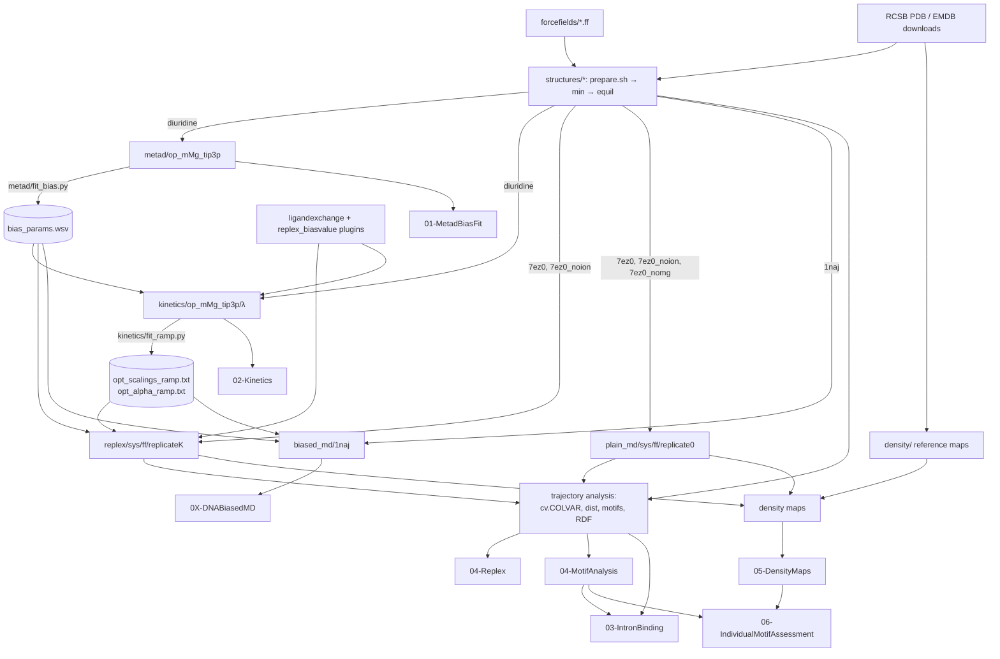

# Reproduction pipeline (draft)

How every result in `paper/` is produced, from public inputs to figures and tables.
Paths are relative to the repository root (`$PROJECT_DIR`). All shell scripts assume
`source env.sh` (sets `PROJECT_DIR`, `GMX`, `GMXLIB=forcefields/`, adds `scripts/` to
`PATH`, activates `.venv`).

Status: ✅ scripted and outputs present · ⚠️ scripted, but the script does not match
what was run, or a manual step is involved · ❓ information missing

## Overview

Out of scope for now: CASP17 (`casp17/`, `07-CASP17`). Deferred: density maps (to be redone).

## 0. Software and external dependencies

| Item | Where | Status |
|---|---|---|
| GROMACS 2023.5 patched with PLUMED 2.10 (`gromacs/2023/2023.5-plumed-2.10b`, `plumed/2.10/2.10bnl-patch` on Leonardo) | cluster modules | ✅ |
| PLUMED plugins `LigandExchange.so`, `ReplexBiasValue.so` | external repos `ligandexchange/`, `replex_biasvalue/` (`make`), see README | ✅ (commit/version to pin ❓) |
| pdbfixer | `pyproject.toml` (git pin) | ✅ |
| Python package `mg_sampling` | `src/`, `pyproject.toml` | ⚠️ `cryomap`, `array-api-compat` missing from dependencies |
| cryomap (density maps) | not in repo | ❓ source and version |

## 1. Force fields

| Output | Produced by | Status |
|---|---|---|
| `forcefields/amber14sb_{mMg,nMg}_tip3p.ff` | modified by hand; treated as raw input. `forcefields/originals/` is kept for reference only | ✅ |

## 2. Reference data (downloads)

| Output | Produced by | Status |
|---|---|---|
| `structures/{9CBU,9CBW,9CBX,9CBY,7EZ0}_fixed.pdb` | `structures/get_ref_files.sh` (RCSB + pdbfixer) | ✅ |
| `structures/9cbu/9CBU_fixed.pdb` | copy of the above? | ⚠️ |
| `structures/*/ff/7ez0_fixed.pdb` | pdbfixer line in each `prepare.sh` (`--keep-heterogens=all` for 7ez0, `none` for 7ez0_noion) | ⚠️ commented out in `7ez0/mMg_tip3p` and `7ez0_nomg` |
| `density/emd_42499.mrc` (+ 42498, 31385, half maps 1/2) | `density/get_ref_files.sh` (EMDB) | ✅ |
| `density/emd_42499_Con2-2.2A_half_{A,B}.mrc` (used by 05, 06) | downloaded from https://github.com/DasLab/Water-CryoEM-ribozyme/tree/main/maps | ⚠️ add the download to `density/get_ref_files.sh` |
| `structures/diuridine/diuridine.pdb`, `structures/triuridine/triuridine.gro` | taken from another in-group project; raw input | ✅ |

## 3. System preparation (`structures/<system>/<ff>/`)

For each system, run in its folder:

1. `prepare.sh` → `topol.top`, `repNN/ions2.gro` (pdb2gmx, box, solvation, ions). Ion
   recipe: neutralize with Mg²⁺/Na⁺ 3:1, plus 10 mM MgCl₂ + 50 mM NaCl (7ez0_nomg: Na⁺ only,
   50 mM NaCl).
2. `../../min_posre.slurm` → `repNN/min.gro`
3. `../../equil_posre.slurm` → `repNN/equil.{tpr,gro}`
4. `../../process_topol.sh` → `processed.top`
5. `../../ion_motif_analysis.sh` → `repNN/MG_motifs.parquet` (before minimization),
   `repNN/MG_motifs_equil.parquet` (after equilibration)

| System / ff | Replicas on disk | Used by | Status |
|---|---|---|---|
| `7ez0/mMg_tip3p` | 24 | replex, plain_md | ⚠️ `prepare.sh` has `from_rep=16 to_rep=23` (last extension only) |
| `7ez0/nMg_tip3p` | 16 | plain_md (+ `_soft`) | ✅ |
| `7ez0_noion/mMg_tip3p` | 24 | replex, plain_md | ⚠️ same as above |
| `7ez0_noion/nMg_tip3p` | 8 | plain_md | ✅ |
| `7ez0_nomg/mMg_tip3p` | 8 | plain_md | ⚠️ motif files missing (not read by the paper?) |
| `1naj/mMg_tip3p` | — | biased_md | ✅ |
| `diuridine/mMg_tip3p` | single box | metad, kinetics | ✅ own `prepare.sh` (min + equil included, local `min.mdp`/`equil.mdp`) |
| `triuridine/mMg_tip3p` | single box | metad, kinetics | ✅ same |
| `9cbu` | PDB only | motif reference | ✅ `structures/9cbu/ion_motif_analysis.sh` → `MG_motifs.parquet` |

## 4. Bias parameterization

### 4a. Metadynamics on diuridine (and triuridine)
`metad/prepare.sh` → `op_mMg_tip3p/plumed.dat`; `metad/run.slurm` → `COLVAR`, `HILLS`;
`metad/sum_hills.sh` → `fes.dat`; `metad/prepare_static.sh` + `run_static.slurm` →
`static.COLVAR`. Triuridine: same steps with `metad/triuridine/*`. ✅

### 4b. Bias fit → `metad/op_mMg_tip3p/bias_params.wsv` (E, sX, sY)
`metad/fit_bias.py op_mMg_tip3p` (reads `static.COLVAR`, `fes.dat`; never overwrites). ✅
The existing file was produced by `notebooks/02-BiasFitting.ipynb` (L-BFGS-B) and is kept as
the reference. L-BFGS-B is unreliable on this non-smooth loss (it reaches a different minimum
for each scipy version, never the reference), so the script uses Nelder-Mead, which gives the
same result with scipy 1.13–1.17:

| | E | sX | sY | loss |
|---|---|---|---|---|
| `bias_params.wsv` (reference) | 38.307903 | 0.10098 | 0.287523 | 4.660 |
| `fit_bias.py` (Nelder-Mead) | 38.471147 | 0.102034 | 0.292172 | 4.640 |

`metad/triuridine/op_mMg_tip3p/bias_params.wsv` is a copy of the diuridine fit (no
separate fit). ⚠️ The copy step isn't scripted.

### 4c. Kinetics at constant scaling (diuridine)
`kinetics/prepare.sh` (needs `bias_params.wsv`) → `op_mMg_tip3p/{0.6…1.2}/plumed.dat`;
`kinetics/run.slurm` (in each scaling folder) → `COLVAR`. ✅
**Special case, made by hand (no prepare script): the unbiased reference runs
`op_{mMg,nMg}_tip3p/0.0`.** They are kept: being unbiased, the bias bug of the archived runs
doesn't affect them. Their tracked inputs are the record of how they were made:
`plumed.dat` (run) and `plumed_analysis.dat` (post-processing → `cv.COLVAR`, read by
`02-Kinetics`) in each `0.0/` folder. The run used the same `grompp` + `mdrun -plumed
plumed.dat` as `kinetics/run.slurm`, with `nsteps` changed by hand; the post-processing is
`plumed driver --plumed plumed_analysis.dat --ixtc run.xtc --trajectory-stride 0 --timestep 0.002`
(`op_mMg_tip3p/0.0/analysis.slurm`). The two runs use different restraints:

| Run | Set up | Restraint (`plumed.dat`) | Length | PLUMED |
|---|---|---|---|---|
| `op_mMg_tip3p/0.0` | May 2026, by hand from the 0.6 `plumed.dat` with `bias:` commented out | `UPPER_WALLS` at 0.8 nm on Mg – **COM(O1P, O2P)** distance | 5·10⁹ steps = 10 µs (`nsteps` edited by hand; `run.mdp` says 400 ns) | 2.9.2 |
| `op_nMg_tip3p/0.0` (and `op_mMg_opc/0.0`, not used) | May 2025, by hand; index group `O_Phosphate_1` as in `archive/prepare.sh` | `UPPER_WALLS` at 0.8 nm on Mg – **single O1P** distance | 5·10⁸ steps = 1 µs | 2.10b |

The biased runs (0.6–1.2) use the same restraint as `op_mMg_tip3p/0.0` (wall on Mg –
COM(O1P, O2P), from `kinetics/prepare.sh`), so `op_nMg_tip3p/0.0` is the odd one out.
`02-Kinetics` compares these two runs, which use different restraint definitions. Also,
`op_nMg_tip3p/0.0/plumed.slurm` regenerated `../index.ndx` in Feb 2026 with the new groups,
so the index used for that run is gone.
Decision: keep both runs as they are; the difference in restraint (wall on a single O1P vs
on the COM of O1P/O2P, both at 0.8 nm) is not expected to affect the results.Triuridine at scaling 1.0: `kinetics/triuridine/prepare.sh` + `run.sh` (reuses the
diuridine `bias_params.wsv`). ✅

### 4d. Scaling optimization → `kinetics/op_mMg_tip3p/opt_{scalings,alpha}_ramp.txt`
`kinetics/fit_ramp.py op_mMg_tip3p` (from the 4c `COLVAR` files; never overwrites). ✅
Three steps: WHAM over the 7 runs; α(λ) such that ΔG_bind doesn't depend on λ
(deterministic); ladder λ_k (12 replicas, λ 0 → 1) with uniform exchange acceptance, after
resampling M = 150 independent systems (stochastic, `--seed`).
The existing files were produced by `notebooks/04-FittingRamp.ipynb` (unseeded) and are kept
as the reference. Checks:
- α: the refit at the saved λ_k matches `opt_alpha_ramp.txt` within 5·10⁻⁶ kJ/mol.
- λ_k: refits with seeds 0–2 differ from the saved ladder by ≤ 0.013; on their resampled
  data, the saved ladder gives acceptances 0.58–0.62 (refits: uniform 0.595–0.600).

Replex uses the first 8 values (λ up to 0.866): the benefit saturates above λ ≈ 0.8.
`kinetics/prepare_ramp.sh` (validation runs `op_mMg_tip3p_ramp`) hard-codes the alphas;
those runs are no longer on disk and the paper doesn't read them.

## 5. Production simulations

### 5a. Replica exchange (`replex/<sys>/mMg_tip3p/replicate{0,1}/`)
Systems `7ez0`, `7ez0_noion`; replicate 0 uses equilibrated replicas 00–07, replicate 1
uses 08–15.
1. `replex/prepare.sh` (edit `system`, `replicate`, `from_rep`, `to_rep` per call) →
   `index.ndx`, `ref_subset.pdb`, `bias_params.wsv`, `opt_*_ramp.txt`, `plumed.dat` (via
   `generate_plumed.sh`), `processed.top`, `repNN/input.gro`.
2. `replex/run.slurm` → `repNN/run.{tpr,xtc}`, `bias.COLVAR.<i>`, `rmsd.COLVAR.<i>`,
   `bias_index.xvg` (PLUMED outputs; `<i>` = replica index 0–7). Final length 300 ns
   (`-until 300000`). ⚠️ The committed `run.slurm` is set to debug QOS / 30 min (two
   `--time` lines); restore the production settings.

### 5b. Plain MD (`plain_md/<sys>/<ff>/replicate0/repNN`, 8 replicas each)
`7ez0/{mMg,nMg,nMg_soft}`, `7ez0_noion/{mMg,nMg}`, `7ez0_nomg/mMg`.
1. `plain_md/prepare.sh` (soft: `prepare_soft_restr.sh` + `generate_plumed_soft.sh`) →
   `plumed.dat` (RMSD restraint), `processed.top`, `repNN/input.gro`.
2. `plain_md/run_single_light.slurm` in each `repNN/` (all final systems; `-until 600000`
   = 600 ns). ⚠️ The notebooks stop `7ez0_nomg` at frame 4000 (400 ns): check whether those
   runs are shorter. `run_multi*.slurm`, `run_single_light_noappend.slurm` and `run.slurm`
   are not needed.
⚠️ `prepare.sh` creates `<sys>/<ff>/repNN`, but the data (and every notebook) use
`<sys>/<ff>/replicate0/repNN`: the `replicate0/` level was added by hand.
⚠️ `plain_md/run.slurm` is broken (`$rep` undefined).

### 5c. Biased MD on DNA (`biased_md/1naj/mMg_tip3p`)
`biased_md/prepare.sh` (λ index 7, uses `bias_params.wsv` + `opt_*_ramp.txt`) +
`run_single_light.slurm`. ✅

### 5d. CASP17 (`casp17/W2385`, `W2386`)
Out of scope for now (inclusion in the paper undecided). No preparation or run scripts tracked.

## 6. Trajectory analysis

| Output | Produced by | Read by | Status |
|---|---|---|---|
| `replex/.../repNN/cv.COLVAR.<n>` | `replex/analysis.slurm` (`generate_plumed_analysis.sh` + `plumed driver`) | 04-Replex | ⚠️ suffix `<n>` is the folder number (08–15 in replicate 1), unlike `bias.COLVAR.<i>` (0–7) |
| `replex/.../repNN/dist_{MG_O_Phosphate,O_Phosphate_MG}.xvg` | `replex/compute_ion_dist.slurm` | 04-Replex | ✅ |
| `{replex,plain_md}/.../repNN/{MG,NA}_motifs.parquet` | `replex/ion_motif_analysis.{sh,slurm}`, `plain_md/ion_motif_analysis.sh` (CLI `ion_motif_analysis`) | 03, 04-MotifAnalysis, 06 | 🔁 to be rerun during the analysis refactor; keep one variant (the two replex scripts differ: `--outer_cutoff 5.0 --standardize` vs `--outer_cutoff 0`) |
| `replex/7ez0/mMg_tip3p/replicate0/remuxed/0_trajout.xtc` | `replex/remux.sh` (`trjcat -demux`) | — | ✅ |
| `.../remuxed/0_{MG,NA}_RNA_rdf.xvg` | `.../remuxed/compute_rdf.sh` | 03 | ⚠️ 03 reads `remux/`, the files are in `remuxed/` |
| `plain_md/7ez0/nMg_tip3p/replicate0/rep00/{MG,NA}_RNA_rdf.xvg` | `plain_md/compute_rdf.sh` | 03 | ⚠️ script currently set to `refs="CL"` |
| `density/*` | to be fully redone (`density/density_maps.py`, cryomap); old outputs and their generators are ignored for now | 05, 06 | ⏸ deferred |

## 7. Paper notebooks (run order)

| Order | Notebook | Reads | Writes |
|---|---|---|---|
| 1 | `01-MetadBiasFit` | metad COLVAR/static.COLVAR/bias_params (di- and triuridine) | `figures/metad_fes`, `bias_barrier`, triuridine variants |
| 2 | `02-Kinetics` | kinetics COLVARs (0.0–1.2, triuridine), `bias_params.wsv` | kinetics figures |
| 3 | `04-Replex` | replex `bias.COLVAR`, `cv.COLVAR`, `bias_index.xvg`, `dist_*` | `figures/replex/*` ⚠️ only works for replicate 0 (reads `rep{i:02d}`, `rep00`) |
| 4 | `04-MotifAnalysis` | motif parquets (replex, plain_md, structures, 9cbu), `bias.COLVAR` | `*_summary*.parquet` (back into the simulation folders), motif table, `figures/motif_analysis` |
| 5 | `03-IntronBinding` | motif parquets, **summaries from 04-MotifAnalysis**, RDFs, replex/plain trajectories | ion-binding figures, `ion_count_bulk.csv` (cache) ⚠️ numbered 03 but runs after 04-MotifAnalysis |
| 6 | `05-DensityMaps` | density maps, EM maps, `9CBU_fixed.pdb`, replex trajectory | `best_tempfactors*.csv`, `cross_correlations.csv`, `cc_p_values.csv`, `tempfactor_scan*.parquet`, map figures |
| 7 | `06-IndividualMotifAssessment` | `best_tempfactors.csv` (from 05), summaries (from 04-MotifAnalysis), individual maps | `motif_{table,count,recovery}.tex`, `motif_highlight/*`, figures |
| — | `07-CASP17` | casp17 trajectories | out of scope for now |
| — | `0X-DNABiasedMD` | biased_md trajectories | per-rep parquet cache |

Not in the chain (keep or retire? ❓): `Figures copy 3`, `IndividualSiteAssessment`,
`IonCompetitionModel`, `RNADynamics`.

## Open questions

1. Are the `7ez0_nomg` plain MD runs 400 ns rather than 600 ns?

Resolved: the unbiased `kinetics/*/0.0` runs are kept as they are, despite their different
restraints; all final plain MD systems used `run_single_light.slurm`; force fields are hand-modified raw inputs; `diuridine.pdb` and `triuridine.gro`
are raw inputs from another in-group project; the triuridine `bias_params.wsv` is a copy
of the diuridine fit; the Con2-2.2A half maps come from the DasLab Water-CryoEM-ribozyme
repository; replex runs are 300 ns; motif files will be regenerated during the analysis
refactor; density will be redone; CASP17 is out of scope for now.

## Removing `notebooks/` (in progress)

Rule: a script produces anything a later stage reads; notebooks (`paper/`) only read and plot.
No figure from `notebooks/` is kept. Only two notebooks produce pipeline inputs:

1. ✅ Bias fit (`02-BiasFitting`) → `metad/fit_bias.py`. Done alongside it: `tools.read_plumed_fes`
   no longer drops duplicate times (`fes.dat` has no `time` column).
2. ✅ Ramp fit (`04-FittingRamp`) → `kinetics/fit_ramp.py`.
3. ✅ Package cleanup: `bias.py` keeps `bias_fn` and the fit constants; `classes.py` keeps
   `Sim`, `MetadSim`; removed `optimize_scalings.py` (and its entry point), `stringbase.py`, `plot.py`.
4. ⏸ Remove `notebooks/` (next): tag the current commit (e.g. `pre-notebooks-removal`), list
   untracked files in `notebooks/` (`figures/`, ~400 MB of `*.mrc`, `*.csv`, `*.pdb`) for
   confirmation, `git rm -r notebooks/`, check for remaining references, update this file.

Pending: remove the dangling `read_exchanges` and `compare_density` entry points from
`pyproject.toml` (their modules no longer exist)? Reinstall the package (`uv pip install -e .`)
to drop the stale `optimize_scalings` command from `.venv/bin`.
Uncommitted so far: `metad/fit_bias.py`, `kinetics/fit_ramp.py`, the `src/mg_sampling` changes
(`tools.py` fix, `bias.py`, `classes.py`, 3 modules removed) and `pyproject.toml`.

## Refactoring implications (preliminary)

- **Needed for reproduction, keep:** `classes.MetadSim` (bias fit), `optimize_scalings`,
  `ion_motif_analysis`, `tools`, `bias`, `constants`, `parallel`; from `density.align`:
  `reorder_residue_atoms`, `standardize_names`, `check_alignable`.
- **Move into `paper/`** (or turn into scripts): the bias fit (`notebooks/02-BiasFitting`)
  and scaling optimization (`notebooks/04-FittingRamp`). Then the rest of `notebooks/` can go.
- **Make scripts take arguments** instead of hand-edited variables (`system`, `replicate`,
  `from_rep`, `to_rep`, `forcefields`, `refs`), so one command per step reproduces all systems.
- **Unify conventions:** `remux` vs `remuxed`; COLVAR suffixes; the `replicate0/` level in `plain_md`.
- **Density:** switch 05/06 to `density/global` (cryomap); then drop `mg_sampling.density.{grid,forward_density,plot,utils}`
  and `density/forward_density_*.py`.
